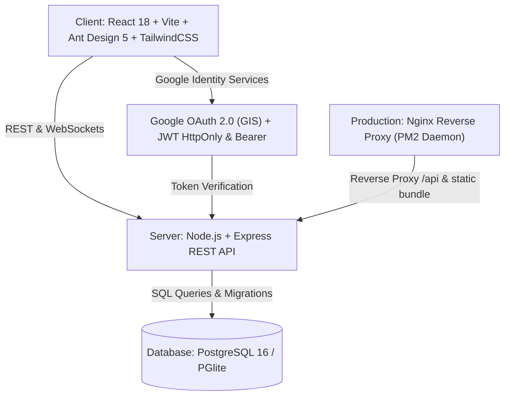

# FSKTM Facility & Maintenance Management System (FSKTM FMS)
## Comprehensive Technical Documentation, System Architecture & Operational Guide
**Universiti Tun Hussein Onn Malaysia (UTHM)**  
*Faculty of Computer Science and Information Technology (FSKTM)*

---

## 1. Executive Summary

The **FSKTM Facility & Maintenance Management System (FSKTM FMS)** is a web-based enterprise resource planning and smart campus operational management platform. Built specifically for FSKTM at Universiti Tun Hussein Onn Malaysia (UTHM), it automates and integrates:
- Real-time lab and smart classroom bookings across 4 faculty floors.
- Instant QR code classroom check-in, real-time timetable display, and quick feedback submission.
- Equipment checkout, tracking, barcode/serial inventory, and hardware loan management.
- Fault reporting, breakdown ticketing, and technician maintenance tracking.
- Role-based administration, CSV academic timetable synchronization, and role permission audits.
- Multi-tier dual-channel authentication supporting both official UTHM Google Identity OAuth 2.0 (`@student.uthm.edu.my`) and credentials.

---

## 2. System Architecture & Tech Stack



### 2.1. Frontend Architecture
- **Framework:** React 18 with Vite bundling.
- **Component & Design System:** Ant Design 5 (customized with UTHM corporate blue palette `#0F172A`, `#1E3A8A`, `#2563EB`) and Tailwind CSS.
- **State & Context:**
  - `AuthContext`: Centralized session restoration, Google OAuth handoff, persistent JWT in `localStorage`, and role-based guards.
  - Global `fetch` interceptor automatically attaching `Authorization: Bearer <token>` and `credentials: include` to all `/api/*` endpoints.
- **Icons & Visuals:** Ant Design Icons, Lucide React, and official UTHM University insignia.

### 2.2. Backend Architecture
- **Runtime:** Node.js LTS with Express.js.
- **Security & Middleware:**
  - `cookie-parser` for secure session cookies.
  - `cors` with origin reflection and credentials allowance.
  - `app.set('trust proxy', 1)` for SSL/proxy protocol identification.
  - Role-based authorization middleware enforcing permission trees: `student`, `lecturer`, `technician`, `manager`.
- **Database Engine:** Persistent PostgreSQL 16 engine with schema migration, relationship constraints, and foreign key cascades.

---

## 3. User Roles & Permission Hierarchy

The system enforces a 4-tier Role-Based Access Control (RBAC) model:

| Role | Target Users | Portal / Route | Capabilities & Permissions |
| :--- | :--- | :--- | :--- |
| **Student** | Undergraduate & Postgraduate students (`@student.uthm.edu.my`) | `/student`, `/login/student` | • Browse 4-floor interactive map.<br>• View lab availability & schedules.<br>• Submit room booking requests.<br>• Borrow available peripherals & lab equipment.<br>• Report broken equipment/facilities via Quick QR portal.<br>• Track status of personal bookings and tickets. |
| **Lecturer** | Academic staff & course coordinators | `/lecturer`, `/login/lecturer` | • All Student capabilities.<br>• Instant lab and lecture hall reservations.<br>• Book weekly recurring class slots.<br>• View live schedules and room occupancy. |
| **Lab Technician** | Technical officers & IT staff | `/staff`, `/login/staff` | • Centralized operational command desk.<br>• Manage inventory catalog (add, edit, inspect hardware).<br>• Process device loan requests (issue, check-in, mark returned).<br>• Triage breakdown tickets (open, in progress, resolved).<br>• Log maintenance actions and service records.<br>• Toggle room maintenance status in real time. |
| **Lab Manager / Admin** | Faculty administrator & Dean's Office | `/admin/users`, `/admin/rooms`, `/admin/reports` | • Full administrative authority.<br>• Manage user accounts, role authorizations, and staff provisioning.<br>• Reverse-chronological user directory (newest users listed at top).<br>• Bulk import semester class timetables via CSV parser.<br>• Generate utilization, maintenance, and ticket audit analytics. |

---

## 4. Key Modules & Functional Workflows

### 4.1. Dual-Channel Authentication & Session Management
- **Google One-Tap / Button Login:** Students authenticate using official `@student.uthm.edu.my` Siswamail. On first login, their user profile (name, matric number, department, specialization) is extracted and provisioned automatically.
- **Standard Password Login:** Users can sign in using their email/matric ID and password.
- **Resilient Dual Storage:** Auth tokens are passed via HttpOnly cookies and stored in browser `localStorage`. API calls send `Authorization: Bearer <token>` headers, ensuring reliable operation over both HTTP and HTTPS.
- **Remember Me Functionality:** Safely stores credentials client-side for auto-fill on subsequent sessions.

### 4.2. Interactive Facility & Classroom Booking
- **Multi-Floor Interactive Directory:** Visual floor plan across Ground, 1st, 2nd, and 3rd floors covering 49 authentic FSKTM rooms (e.g., Makmal Sains Data, Makmal Realiti Maya, Makmal Grafik dan Animasi, Dewan Teater 1).
- **Conflict Prevention Engine:** Server-side validation rejects overlapping reservations for the same room and time window.
- **Automated Timetable CSV Import:** Bulk semester schedule parser mapping Course ID, Section, Day, Time, and Venue to automatically populate class reservations.

### 4.3. Quick QR Facility Check-in & Incident Reporting
- **Dynamic QR Integration:** Accessible via `/qr/:locationCode` (e.g., `/qr/DT1`, `/qr/MSD`).
- **Real-Time Room Status:** Displays ongoing class or booking, current lecturer, and upcoming schedule.
- **Public & Authenticated Feedback:** Allows students and visitors to scan a classroom QR code, report issues with photos, and trigger immediate technician dispatch.

### 4.4. Hardware Inventory & Loan Counter
- **Peripherals Catalog:** Real-time stock counts for laptops, Arduino/Raspberry Pi developer kits, projectors, HDMI adapters, VR headsets, and testing devices.
- **Loan Lifecyle:** Automated checkout, loan approval, due date tracking, and check-in return verification.

### 4.5. Maintenance & Breakdown Ticketing
- **Ticket Lifecycle:** `open` &rarr; `in_progress` &rarr; `resolved` &rarr; `closed`.
- **Maintenance Logs:** Records technician notes, parts replaced, and costs.
- **Room Status Integration:** Marking an issue as severe updates the classroom state to `maintenance`, preventing double-booking during repairs.

---

## 5. Database Schema Overview

```
                      +-------------------+
                      |       users       |
                      +-------------------+
                      | user_id (PK)      |
                      | name              |
                      | email (UNIQUE)    |
                      | role              |
                      | matric_or_staff_id|
                      | created_at        |
                      +---------+---------+
                                |
        +-----------------------+-----------------------+
        | 1:N                   | 1:N                   | 1:N
+-------v-------+       +-------v-------+       +-------v-------+
|   bookings    |       |  device_loans |       | issue_reports |
+---------------+       +---------------+       +---------------+
| booking_id PK |       | loan_id PK    |       | report_id PK  |
| location_id FK|       | device_id FK  |       | location_id FK|
| user_id FK    |       | user_id FK    |       | user_id FK    |
| start_time    |       | borrow_date   |       | description   |
| end_time      |       | return_date   |       | status        |
| status        |       | status        |       | image_url     |
+-------^-------+       +-------^-------+       +-------^-------+
        |                       |                       |
+-------+-------+       +-------+-------+               |
|   locations   |       |    devices    |               |
+---------------+       +---------------+               |
| location_id PK|       | device_id PK  |               |
| code (UNIQUE) |       | name          |               |
| name          |       | serial_number |               |
| floor         |       | status        |               |
| status        |       +---------------+               |
+---------------+                                       |
        | 1:N                                           |
        +-----------------------+-----------------------+
                                | 1:N
                      +---------v---------+
                      | maintenance_logs  |
                      +-------------------+
                      | log_id PK         |
                      | location_id FK    |
                      | device_id FK      |
                      | technician_id FK  |
                      | report_id FK      |
                      | description       |
                      | cost              |
                      | performed_at      |
                      +-------------------+
```

---

## 6. Pre-Seeded Default Test Accounts

| Role | Login Identifier | Default Password | Portal Route |
| :--- | :--- | :--- | :--- |
| **Lab Manager** | `manager@fsktm.um.edu.my` | `Password123!` *(or `Manager123!`)* | `/login/staff` |
| **Lab Technician** | `technician@fsktm.um.edu.my` | `Tech123!` | `/login/staff` |
| **Lecturer** | `lecturer@fsktm.um.edu.my` | `Lecturer123!` | `/login/lecturer` |
| **Academic Staff** | `norasri@uthm.edu.my` | `Lecturer123!` | `/login/lecturer` |
| **Student** | `student@fsktm.um.edu.my` | `Student123!` | `/login/student` |
| **Student (UTHM)** | `ai230199@student.uthm.edu.my` | `Student123!` *(or Google Login)* | `/login/student` |

---

## 7. Deployment & Server Operations

### 7.1. Live Server Configuration
- **Host IP:** `10.65.200.38` (or `http://10.65.200.38.sslip.io`)
- **Web Server:** Nginx 1.28.x reverse-proxying `/api` to port `5001` and serving static client dist from `/var/www/client/dist`.
- **Process Manager:** PM2 managing `fms-api` (`node src/server.js`) under user `sysadmin`.
- **Root Directory:** `/var/www`

### 7.2. One-Line Production Deployment
To pull latest updates, re-build production frontend, and restart the backend API daemon:
```bash
cd /var/www && git pull origin main && cd client && npm run build && pm2 restart fms-api
```

### 7.3. Local Development Start
To run the full stack locally:
1. Start backend:
   ```bash
   cd server && node src/server.js
   ```
   *(Runs on `http://localhost:5001`)*
2. Start frontend:
   ```bash
   cd client && npm run dev
   ```
   *(Runs on `http://localhost:5173`)*
